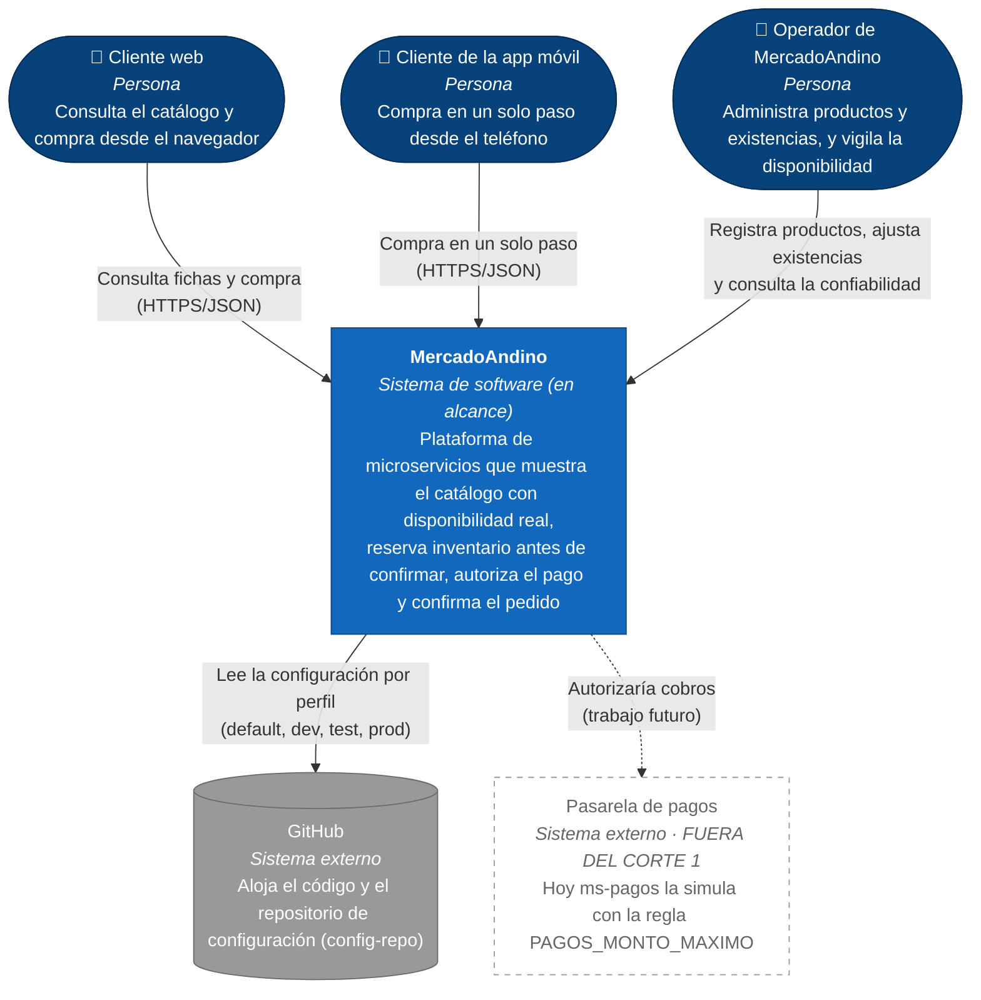

# C4 · Nivel 1 · Contexto del sistema

**Pregunta que responde:** ¿qué es MercadoAndino, quién lo usa y con qué otros sistemas habla?
**Audiencia:** el cliente, la gerencia y cualquier persona no técnica. No muestra tecnologías ni puertos.

**Leyenda:** azul oscuro = persona · azul = sistema en alcance · gris = sistema externo · borde punteado = no se construye en este corte.

## Notas

- El **cliente web** y el de la **app móvil** usan el mismo canal (`bff-web`); el BFF existe porque la app «no debe hacer seis llamadas» (requerimiento 3).
- El **operador** no usa el BFF: llama directamente a las API administrativas de `ms-catalogo` (`POST/PUT/DELETE /api/v1/productos`) y `ms-inventario` (`POST/PUT /api/v1/existencias`), y a `ms-confiabilidad` para el requerimiento 5.
- La **pasarela de pagos** aparece punteada a propósito: el código de `ms-pagos` **no** llama a ningún sistema externo (autoriza por regla interna). Dibujarla como real sería un defecto del documento (regla 3 de la ficha A11).
