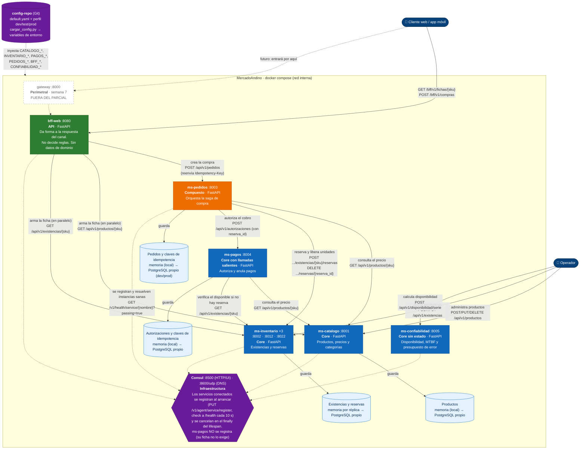

# C4 · Nivel 2 · Contenedores

**Pregunta que responde:** ¿en qué piezas desplegables se divide MercadoAndino, qué tecnología usa cada una y cómo se comunican?
**Audiencia:** el equipo de desarrollo y operaciones; el docente en la revisión de arquitectura.

Cada caja es un **contenedor C4**: un proceso con su propio ciclo de vida, su propia imagen Docker y, cuando es *core*, su propio almacén de datos.

**Leyenda de tipos (taxonomía del syllabus):** 🟩 API · 🟧 Compuesto · 🟦 Core · 🟪 Infraestructura · borde punteado = fuera del parcial. Flechas continuas = llamadas de negocio por HTTP/JSON con `httpx`; punteadas = plataforma (registro, descubrimiento, configuración).

## Tabla de contenedores

| Contenedor | Puerto | Tipo | Datos propios | Prefijo de variables | Llama a |
|---|---|---|---|---|---|
| `bff-web` | 8080 | API | ninguno | `BFF_` | `ms-pedidos`, `ms-catalogo`, `ms-inventario` |
| `ms-pedidos` | 8003 | Compuesto | estado del pedido + claves de idempotencia (no de dominio de catálogo ni inventario) | `PEDIDOS_` | `ms-catalogo`, `ms-inventario`, `ms-pagos` |
| `ms-catalogo` | 8001 | Core | productos | `CATALOGO_` | — |
| `ms-inventario` (×3) | 8002, 8012, 8022 | Core | existencias y reservas | `INVENTARIO_` | — |
| `ms-pagos` | 8004 | Core con llamadas salientes | autorizaciones + claves de idempotencia | `PAGOS_` | `ms-catalogo`, `ms-inventario` (excepción de la semana 3) |
| `ms-confiabilidad` | 8005 | Core sin estado | ninguno (cálculo puro) | `CONFIABILIDAD_` | — |
| Consul | 8500, 8600/udp | Infraestructura | catálogo de servicios | — | — |
| `config-repo` | — | Infraestructura (Git) | YAML por servicio y perfil | — | — |

## Notas de implementación

- **Base de datos por servicio:** en el corte 1 cada servicio usa un repositorio en memoria detrás de un `Protocol`; el perfil `dev`/`prod` de `config-repo` apunta a un PostgreSQL **propio** de cada servicio. Ningún servicio lee la base de otro: el acceso es solo por su API.
- **Réplicas de inventario:** cada réplica tiene su propia memoria, por lo que en el corte 1 las existencias **no** se comparten entre réplicas. Es una limitación conocida, documentada por A02 y registrada en [`trazabilidad.md`](trazabilidad.md#3-revisión-cruzada-contra-el-código).
- `ms-pagos` usa direcciones **estáticas** (`PAGOS_URL_CATALOGO`, `PAGOS_URL_INVENTARIO`) y **no se registra en Consul** (la ficha A03 no lo pide). Por eso `ms-pedidos` debe llegar a `ms-pagos` por `PEDIDOS_URL_PAGOS` o el nombre del contenedor en la red de Compose. Ver divergencia D3 en [`trazabilidad.md`](trazabilidad.md#3-revisión-cruzada-contra-el-código).
- Los consumidores con descubrimiento por Consul son `ms-pedidos` y `bff-web`; el único servicio con varias réplicas es `ms-inventario`.
