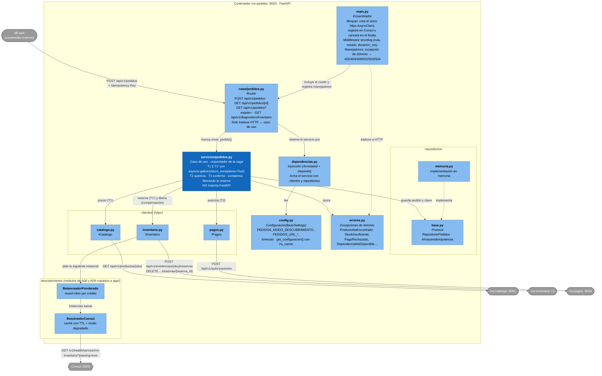

# C4 · Nivel 3 · Componentes de `ms-pedidos`

**Pregunta que responde:** ¿cómo está organizado por dentro el contenedor más complejo, quién es responsable de qué y por dónde entra y sale cada petición?
**Audiencia:** quienes programan o revisan `ms-pedidos` (A04) y quienes integran con él.

`ms-pedidos` es el **orquestador de la saga** de compra. Se eligió para el nivel 3 porque concentra las decisiones más delicadas: llamadas en paralelo, compensación, idempotencia y traducción de fallos.

**Leyenda:** azul oscuro = núcleo del dominio (caso de uso) · azul claro = componentes de soporte · gris = contenedores externos a `ms-pedidos`.

## Reglas que el diagrama hace visibles

| Regla | Dónde se ve |
|---|---|
| La capa de servicio no conoce HTTP | `servicios/pedidos.py` solo habla con `errores`, `repositorios` y `clientes`; `main.py` traduce |
| Un solo `httpx.AsyncClient` | Se crea en el `lifespan` de `main.py` y lo comparten los tres clientes |
| El servicio depende de contratos, no de clases | `repositorios/base.py` y las interfaces `ICatalogo`, `IInventario`, `IPagos` (ver [UML de componentes](UML-componentes.md)) |
| Solo inventario se balancea | Es el único con réplicas; catálogo y pagos tienen una instancia en el corte 1 |
| Nunca queda una reserva huérfana | La compensación vive en el caso de uso, no en el router (ver [secuencias](UML-secuencia-compra.md)) |

> Este nivel 3 describe la arquitectura **objetivo** según la ficha A04. Cuando el código de `ms-pedidos` llegue a `main`, se contrasta archivo por archivo en la [revisión cruzada](trazabilidad.md#3-revisión-cruzada-contra-el-código).
