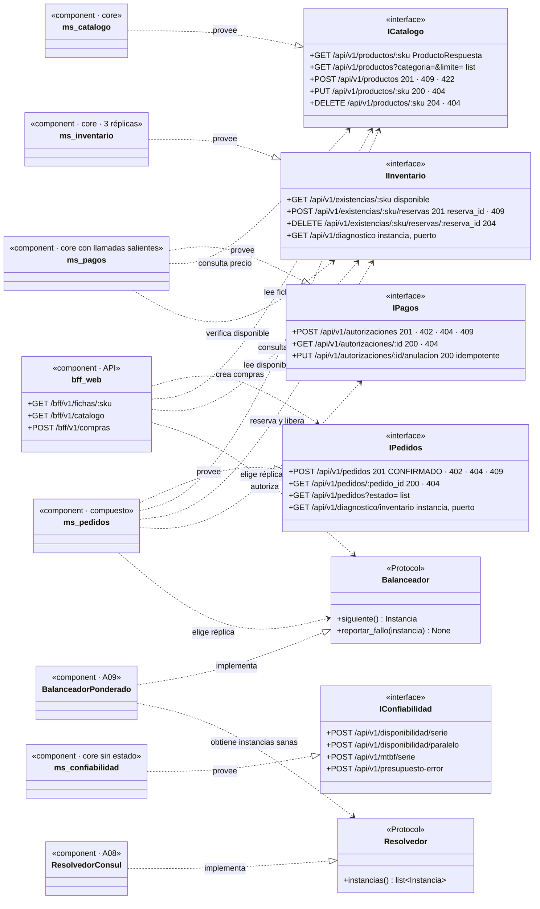
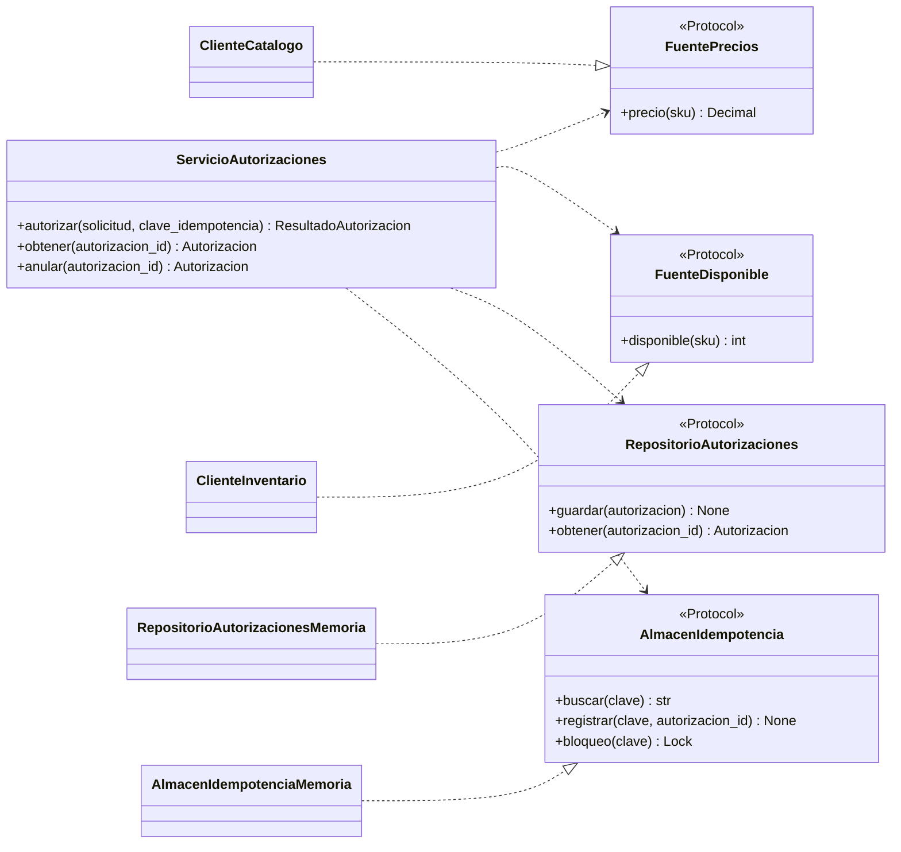

# UML · Diagrama de componentes e interfaces

**Qué muestra:** los componentes de negocio y los **contratos** (interfaces) que exponen y consumen. Un componente depende de una interfaz, nunca de la implementación de otro: así cada equipo pudo avanzar sin esperar al compañero.

En Python estas interfaces son `Protocol` (tipado estructural, sin herencia) en el lado del consumidor y contratos HTTP (`/openapi.json`) en el lado del proveedor.

**Notación:** `..|>` = realiza/provee la interfaz · `..>` = depende de (usa) la interfaz. Dentro de las clases, `:sku` equivale al parámetro de ruta `{sku}` (Mermaid no admite llaves en los miembros).

## Dentro de `ms-pagos` (implementado)

Así se ven los contratos del lado del consumidor en el código real de `servicios/ms-pagos/app/`:

`ServicioAutorizaciones` no sabe si el precio viene de HTTP o de un doble de prueba: por eso `tests/test_servicio.py` lo prueba sin servidor. Es el **principio de inversión de dependencias** aplicado con `Protocol`.
