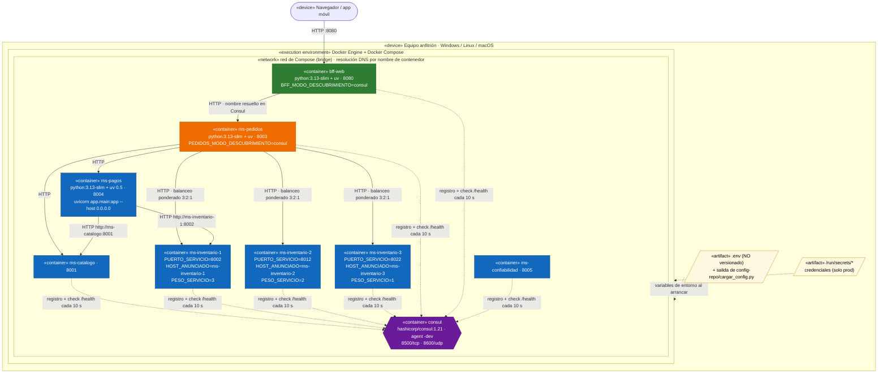

# UML · Diagrama de despliegue

**Qué muestra:** dónde corre cada artefacto en tiempo de ejecución. El entorno del parcial es **un solo nodo** (el equipo anfitrión con Docker Engine) que levanta todo con `docker compose up --build` (A12).

**Leyenda:** 🟩 API · 🟧 Compuesto · 🟦 Core · 🟪 Infraestructura · amarillo = artefactos de configuración.

## Decisiones visibles en el despliegue

| Decisión | Por qué |
|---|---|
| Tres réplicas de `ms-inventario` con pesos 3, 2 y 1 | Demuestra el balanceo ponderado de A09: en 12 peticiones el reparto esperado es 6:4:2 |
| `HOST_ANUNCIADO` = nombre del contenedor | Dentro de un contenedor `localhost` es el propio contenedor: anunciarlo en Consul haría que los consumidores se llamen a sí mismos |
| Identificador `ms-inventario-<host>-<puerto>` | Un identificador repetido haría que una réplica pise el registro de otra |
| `.env` fuera de Git y secretos en `/run/secrets` | Factor III: la configuración vive en el entorno; ninguna credencial entra al repositorio |
| Consul en modo `-dev` | Solo para el parcial: en producción serían 3 o 5 servidores con quórum |
| `ms-pagos` llama a inventario por una URL fija | No usa Consul en el corte 1; con inventario replicado, la URL fija apunta a **una** réplica (ver D4 en [trazabilidad](trazabilidad.md#3-revisión-cruzada-contra-el-código)) |

## Evolución prevista (fuera del parcial)

En producción el nodo único se reemplaza por un clúster (semana 8, Kubernetes): cada contenedor pasa a ser un *Pod*, Consul se sustituye o convive con el `Service` de Kubernetes y el `gateway :8000` (semana 7) se convierte en la única entrada pública. Ver [ADR-002](adr/ADR-002-descubrimiento.md).
