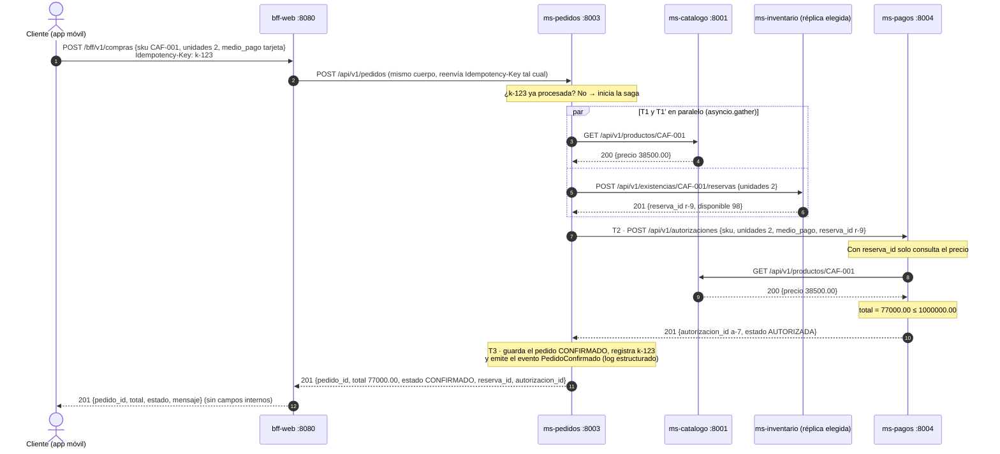
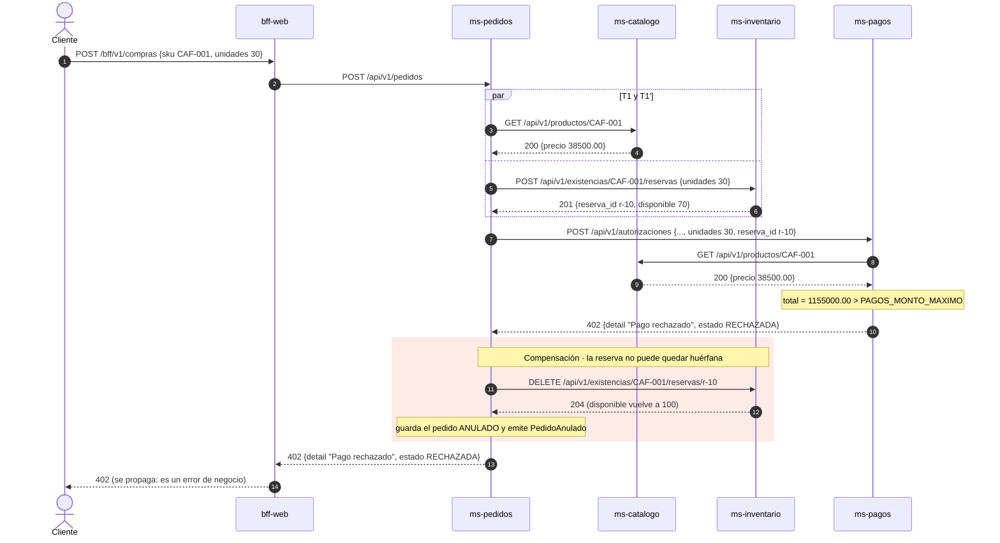
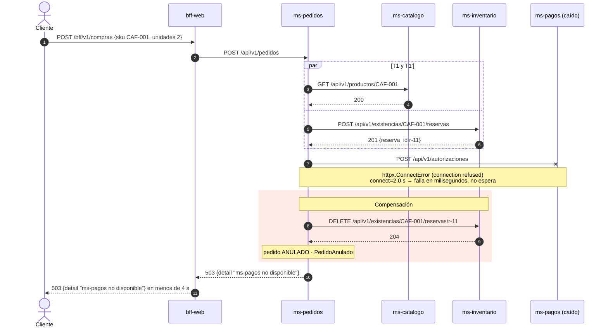
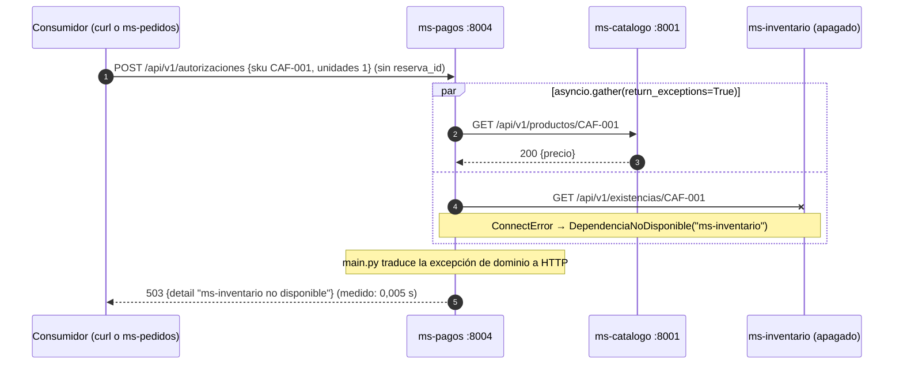

# UML · Secuencias de `POST /bff/v1/compras`

Tres escenarios de la compra en un solo paso (requerimiento 3). `ms-pedidos` **orquesta** la saga: decide el orden, espera las respuestas y compensa cuando algo falla.

Datos de ejemplo de `CONVENCIONES.md`: `CAF-001` cuesta 38 500,00 y tiene 100 unidades; `PAGOS_MONTO_MAXIMO = 1 000 000,00`.

## 1. Flujo feliz

Un reintento con `Idempotency-Key: k-123` devuelve el **mismo** `pedido_id` y `201` sin volver a reservar ni a cobrar.

## 2. Pago rechazado con compensación

Entre el `201` de la reserva y el `204` de la liberación, el inventario mostró 70 disponibles durante unos milisegundos: es la **consistencia eventual** que la saga acepta a cambio de no usar una transacción distribuida.

## 3. Dependencia caída (`503`)

`ms-pagos` está apagado (conexión rechazada) después de que la reserva ya se hizo.

### Variante verificada en el código: `ms-pagos` con `ms-inventario` caído

Es la verificación 10 del E2E y la que hoy se puede reproducir con el código de `main` (`servicios/ms-pagos/tests/test_dependencia_caida_real.py`):

## Qué ve el cliente en cada fallo

| Fallo | Compensación | Respuesta final |
|---|---|---|
| SKU inexistente (T1 → 404) y la reserva sí se hizo | libera la reserva | `404 No existe el producto con SKU X` |
| Stock insuficiente (T1' → 409) | nada que compensar | `409` con `sku`, `solicitado`, `disponible` |
| Pago rechazado (T2 → 402) | libera la reserva | `402 Pago rechazado` |
| `ms-pagos` caído o lento (T2 → 503/504) | libera la reserva | `503`/`504` con el nombre del servicio |
| `ms-inventario` responde 5xx | nada que compensar | `502 ms-inventario respondio mal` |
